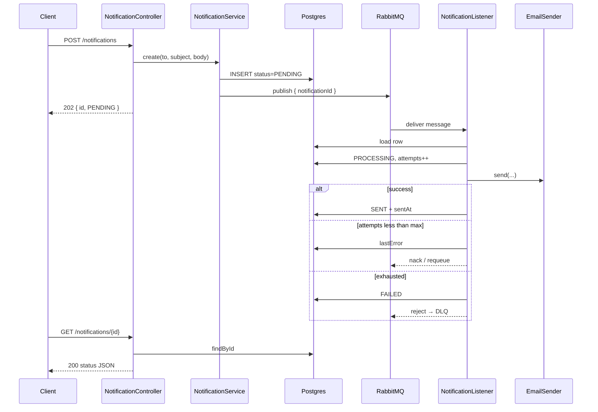

# Notification Worker — Full Project Guide

**Project:** `notification-worker`  
**Package:** `com.satyam.notificationworker`  
**Date:** 2026-08-10 (MVP)  
**Related docs:** [Design Spec](superpowers/specs/2026-08-10-notification-worker-design.md) · [Implementation Plan](superpowers/plans/2026-08-10-notification-worker.md) · [README](../README.md)

---

## 1. What this project is

**Notification Worker** is a small backend service that accepts an email-notification job over HTTP, stores it in **PostgreSQL**, puts a lightweight message on **RabbitMQ**, and has a background **listener** in the same process that actually “sends” the email and updates status.

It is built as a **resume / interview showcase** project. The point is not fancy email templates — it is to demonstrate real backend concepts:

| Concept | How this project shows it |
|---|---|
| Async processing | HTTP returns quickly; work happens on a queue |
| Message queues | RabbitMQ exchange + queue |
| Durability / status tracking | Postgres row is source of truth |
| At-least-once delivery | Messages can be redelivered |
| Idempotency | Already `SENT` / `FAILED` → no double-send |
| Retries | Transient email failures requeue up to N times |
| Dead Letter Queue (DLQ) | Exhausted failures land on `notifications.send.dlq` |
| Swappable integrations | `EmailSender` = logging (default) or SMTP |

**One-liner for interviews:**  
> “HTTP accepts a job, Postgres tracks status, RabbitMQ decouples delivery with retries and a DLQ, and the listener is idempotent under at-least-once delivery.”

---

## 2. What problem it solves

A naive API might send email **inside** the HTTP request:

```
Client → API → SMTP → response
```

Problems:

- Slow or flaky SMTP blocks the API
- Client timeouts / retries can double-send
- Hard to track “did it actually send?”
- No clean place for retries / failure inspection

This project uses the **job queue** pattern:

```
Client → API → save PENDING → publish id to RabbitMQ → 202 Accepted
                              ↓
                         Worker listener
                              ↓
                    load job → send email → SENT / FAILED
```

Clients can poll `GET /notifications/{id}` for status instead of waiting on SMTP.

---

## 3. Tech stack

| Layer | Choice | Version / notes |
|---|---|---|
| Language | Java | **21** |
| Framework | Spring Boot | **3.4.2** |
| Build | Maven | `pom.xml` |
| HTTP | Spring Web + Validation | Bean Validation on DTOs |
| Persistence | Spring Data JPA + Flyway | Schema owned by migrations |
| Database | PostgreSQL | **15** (Compose) |
| Messaging | Spring AMQP / RabbitMQ | **3-management** (Compose) |
| Email | Spring Mail | Optional; logging by default |
| Local deps | Docker Compose | Postgres + RabbitMQ only |
| Tests | JUnit 5, Mockito, Testcontainers | **1.20.6** |

Artifact coordinates: `com.satyam:notification-worker:0.0.1-SNAPSHOT`

---

## 4. High-level architecture

**Single deployable process** hosts both:

1. REST API (accept + query jobs)
2. RabbitMQ listener (process jobs)

```
┌─────────────────────────────────────────────────────────────┐
│                 Spring Boot process (port 8080)             │
│                                                             │
│  NotificationController                                     │
│           │                                                 │
│           ▼                                                 │
│  NotificationService                                        │
│     ├─ save PENDING ───────────────────────▶ PostgreSQL     │
│     └─ publish { notificationId } ─────────▶ RabbitMQ       │
│                                                             │
│  NotificationListener ◀── consume notifications.send        │
│     ├─ load row / skip if SENT|FAILED                       │
│     ├─ PROCESSING + attempts++                              │
│     ├─ EmailSender.send(...)                                │
│     └─ SENT  or  retry  or  FAILED → DLQ                    │
└─────────────────────────────────────────────────────────────┘
```

### End-to-end sequence



### Important design choice: persist, then publish

`NotificationService` saves the row **first** (committed), then publishes to RabbitMQ.

Why: if publish happened inside an open DB transaction, the listener could load the id **before** the insert was visible → “notification not found” → DLQ by mistake.

If publish fails after insert, the row is marked `FAILED` with a clear `lastError` (honest MVP behavior; a production system might use a **transactional outbox** instead).

---

## 5. Project structure

```
notification-worker/
├── pom.xml
├── docker-compose.yml          # Postgres + RabbitMQ
├── README.md                   # Quick start
├── docs/
│   ├── PROJECT-OVERVIEW.md     # This document
│   └── superpowers/
│       ├── specs/...-design.md
│       └── plans/...-worker.md
└── src/
    ├── main/
    │   ├── java/com/satyam/notificationworker/
    │   │   ├── NotificationWorkerApplication.java
    │   │   ├── api/            # HTTP layer
    │   │   ├── config/         # App properties
    │   │   ├── domain/         # Entity + status enum
    │   │   ├── repo/           # Spring Data repository
    │   │   ├── service/        # Business orchestration
    │   │   ├── messaging/      # RabbitMQ topology + listener
    │   │   └── email/          # EmailSender implementations
    │   └── resources/
    │       ├── application.yml
    │       └── db/migration/V1__notification.sql
    └── test/java/...           # Unit + Testcontainers integration tests
```

---

## 6. Package-by-package walkthrough

### 6.1 `api` — HTTP layer

| Class | Role |
|---|---|
| `NotificationController` | Maps `POST /notifications` and `GET /notifications/{id}` |
| `CreateNotificationRequest` | Incoming JSON: `to`, `subject`, `body` (+ validation) |
| `CreateNotificationResponse` | Outgoing create response: `id`, `status` |
| `NotificationResponse` | Full status DTO for GET (does **not** include email body) |
| `GlobalExceptionHandler` | Validation → **400**; missing id → **404** (ProblemDetail) |

### 6.2 `service` — orchestration

| Class | Role |
|---|---|
| `NotificationService` | Persist job, publish message, load by id |
| `NotificationNotFoundException` | Thrown when GET id does not exist |

### 6.3 `domain` + `repo` — persistence

| Class | Role |
|---|---|
| `Notification` | JPA entity mapped to table `notification` |
| `NotificationStatus` | Enum: `PENDING`, `PROCESSING`, `SENT`, `FAILED` |
| `NotificationRepository` | `JpaRepository<Notification, UUID>` |

### 6.4 `messaging` — RabbitMQ

| Class | Role |
|---|---|
| `RabbitConfig` | Declares exchange, queue, DLX, DLQ, bindings, JSON converter |
| `NotificationMessage` | Tiny payload: `{ notificationId }` |
| `NotificationListener` | Consumes queue; send + retry + idempotency + DLQ |

### 6.5 `email` — delivery

| Class | Role |
|---|---|
| `EmailSender` | Interface: `void send(to, subject, body)` |
| `LoggingEmailSender` | Default; logs the email (no network) |
| `SmtpEmailSender` | Real SMTP via Spring `JavaMailSender` |
| `EmailSendException` | Runtime wrapper for SMTP failures |
| `EmailConfig` | Documents / organizes the provider switch |

### 6.6 `config`

| Class | Role |
|---|---|
| `NotificationProperties` | `notification.max-attempts`, `notification.email.*` |

---

## 7. Data model (Postgres)

Flyway migration: `src/main/resources/db/migration/V1__notification.sql`  
JPA setting: `ddl-auto: validate` (Hibernate does **not** create tables; Flyway owns schema).

### Table `notification`

| Column | Type | Meaning |
|---|---|---|
| `id` | UUID PK | Job id returned to the client |
| `to_email` | TEXT NOT NULL | Recipient |
| `subject` | TEXT NOT NULL | Subject line |
| `body` | TEXT NOT NULL | Email body (stored; not returned on GET) |
| `status` | TEXT NOT NULL | `PENDING` / `PROCESSING` / `SENT` / `FAILED` |
| `attempts` | INT DEFAULT 0 | How many times the listener tried to send |
| `last_error` | TEXT | Last failure message (truncated in listener) |
| `created_at` | TIMESTAMPTZ | Created |
| `updated_at` | TIMESTAMPTZ | Last update |
| `sent_at` | TIMESTAMPTZ | Set when status becomes `SENT` |

Index: `idx_notification_status` on `status`.

### Status lifecycle

```
PENDING ──▶ PROCESSING ──▶ SENT
                 │
                 └──(retries exhausted)──▶ FAILED
```

- `PENDING` — saved, waiting for worker (or just published)
- `PROCESSING` — listener picked it up; may requeue while still under max attempts
- `SENT` — terminal success
- `FAILED` — terminal failure (publish failed or email retries exhausted)

---

## 8. API reference

Base URL: `http://localhost:8080`

There is **no homepage** at `/`. Opening the root URL shows Spring’s Whitelabel 404 — that is normal.

### `POST /notifications`

**Request**

```json
{
  "to": "a@b.com",
  "subject": "Hi",
  "body": "Hello"
}
```

**Validation**

- `to`, `subject`, `body` must be non-blank
- `to` must look like an email (`@Email`)

**Success — `202 Accepted`**

```json
{
  "id": "56311731-26c6-4257-915d-4a725838eea6",
  "status": "PENDING"
}
```

**Invalid body — `400`**

**Note:** If the DB insert succeeds but RabbitMQ publish fails, the service marks the row `FAILED`. The controller still returns `202` with whatever status the service returned (usually `FAILED` in that edge case).

### `GET /notifications/{id}`

**Success — `200`**

```json
{
  "id": "56311731-26c6-4257-915d-4a725838eea6",
  "to": "a@b.com",
  "subject": "Hi",
  "status": "SENT",
  "attempts": 1,
  "lastError": null,
  "createdAt": "2026-08-10T09:44:58.372955Z",
  "updatedAt": "2026-08-10T09:44:58.410859Z",
  "sentAt": "2026-08-10T09:44:58.408984Z"
}
```

**Unknown id — `404`**

---

## 9. Messaging design (RabbitMQ)

Configured in `RabbitConfig`.

| Piece | Name |
|---|---|
| Main exchange | `notifications` (direct) |
| Routing key | `send` |
| Work queue | `notifications.send` |
| Dead-letter exchange | `notifications.dlx` (direct) |
| DLQ routing key | `send.dlq` |
| Dead-letter queue | `notifications.send.dlq` |

**Message body (only):**

```json
{ "notificationId": "<uuid>" }
```

Why so small?

- Content lives in Postgres (source of truth)
- Listener always reloads latest status / attempts
- Avoids stale or oversized queue payloads

**Management UI:** http://localhost:15672  
**Login:** `guest` / `guest`

---

## 10. Listener behavior (retries, idempotency, DLQ)

Implemented in `NotificationListener` with `notification.max-attempts` (default **3**).

### Step-by-step

1. Receive `NotificationMessage`
2. Load notification by id  
   - Missing → reject without requeue → **DLQ**
3. If status is already `SENT` or `FAILED` → **return** (ack, no-op)  
   - This is **idempotency** for duplicate deliveries
4. Set `PROCESSING`, increment `attempts`, save
5. Call `EmailSender.send(...)`
6. **On success** → `SENT`, set `sentAt`, clear `lastError`
7. **On failure**
   - Save `lastError`
   - If `attempts < maxAttempts` → throw runtime exception → message **requeues**
   - If exhausted → set `FAILED` → throw `AmqpRejectAndDontRequeueException` → RabbitMQ routes to **DLQ**

### Mental model

| Outcome | DB status | Queue action |
|---|---|---|
| First success | `SENT` | Ack |
| Transient fail (attempt 1 or 2) | `PROCESSING` + `lastError` | Requeue |
| Fail on attempt 3 | `FAILED` | Reject → DLQ |
| Redeliver after `SENT` | unchanged | Ack / skip send |
| Unknown id | n/a | Reject → DLQ |

Retries are counted in the **database** (`attempts`), not via RabbitMQ retry plugins. There is **no delay/backoff** in the MVP (immediate requeue).

---

## 11. Email providers

Controlled by `notification.email.provider`.

### `logging` (default)

- Class: `LoggingEmailSender`
- Does **not** send real email
- Logs at INFO, e.g.  
  `Email sent (logging provider): to=..., subject=..., body=...`
- Perfect for local demo and tests

### `smtp`

- Class: `SmtpEmailSender`
- Uses Spring Mail / `JavaMailSender`
- Needs SMTP env vars (`SMTP_HOST`, `SMTP_PORT`, `SMTP_USER`, `SMTP_PASSWORD`, etc.)
- From address: `notification.email.from` (default `noreply@example.com`)

Switch example:

```bash
export NOTIFICATION_EMAIL_PROVIDER=smtp
export SMTP_HOST=smtp.example.com
export SMTP_PORT=587
export SMTP_USER=...
export SMTP_PASSWORD=...
export SMTP_AUTH=true
export SMTP_STARTTLS=true
mvn spring-boot:run
```

---

## 12. Configuration & local infrastructure

### Docker Compose (`docker-compose.yml`)

| Service | Image | Host ports | Credentials |
|---|---|---|---|
| Postgres | `postgres:15` | **5433** → 5432 | db/user/pass = `notification` |
| RabbitMQ | `rabbitmq:3-management` | **5672**, **15672** | `guest` / `guest` |

Postgres uses **5433** on the host so it does not clash with a local Postgres on 5432.

The **app itself is not containerized** in MVP — you run it with Maven.

### Key `application.yml` settings

| Setting | Default |
|---|---|
| `server.port` | `8080` |
| DB URL | `localhost:5433` / database `notification` |
| RabbitMQ | `localhost:5672`, guest/guest |
| `notification.max-attempts` | `3` |
| `notification.email.provider` | `logging` |

---

## 13. How to run (demo walkthrough)

### Prerequisites

- **JDK 21** (not 25+)
- Docker Desktop running

### Start dependencies

```bash
cd /Users/satyamgupta/IdeaProjects/notification-worker
docker compose up -d
```

### Start the app

```bash
export JAVA_HOME=$(/usr/libexec/java_home -v 21)
mvn spring-boot:run
```

Wait for: `Started NotificationWorkerApplication`

### Create a job

```bash
curl -s -X POST http://localhost:8080/notifications \
  -H 'Content-Type: application/json' \
  -d '{"to":"a@b.com","subject":"Hi","body":"Hello"}'
```

Example response:

```json
{"id":"56311731-26c6-4257-915d-4a725838eea6","status":"PENDING"}
```

### Check status

```bash
curl -s http://localhost:8080/notifications/56311731-26c6-4257-915d-4a725838eea6
```

Within about a second (logging provider), expect `"status":"SENT"`.

### What you should see in logs

1. `Published notification message id=...`
2. `Email sent (logging provider): to=a@b.com, subject=Hi, body=Hello`
3. `Notification sent id=... attempts=1`

### Optional checks in RabbitMQ UI

1. Open http://localhost:15672 (`guest`/`guest`)
2. Queues → `notifications.send` (messages get consumed quickly)
3. On forced failures, messages appear in `notifications.send.dlq`

---

## 14. Testing strategy

Run:

```bash
export JAVA_HOME=$(/usr/libexec/java_home -v 21)
mvn test
```

Expect **14 tests**, `BUILD SUCCESS`. No real SMTP required.

| Test class | Type | What it covers |
|---|---|---|
| `NotificationListenerTest` | Unit (Mockito) | Idempotent skip, success, requeue, exhausted → DLQ, missing row |
| `NotificationServiceTest` | Unit (Mockito) | Persist+publish, publish failure → `FAILED`, not-found |
| `NotificationIntegrationTest` | Integration (Testcontainers) | Happy path → `SENT`, retries+DLQ, idempotent redelivery, 400/404 |

Testcontainers spins up real Postgres + RabbitMQ containers for integration tests. Surefire is configured with Docker API **1.44** for Docker Engine 29+.

---

## 15. What is intentionally out of scope (MVP)

These are deliberate omissions — good **v2 / interview talking points**:

1. Auth / multi-tenant APIs  
2. Transactional outbox (stronger publish reliability)  
3. Email templates, attachments, SMS/push  
4. Separate API vs worker deployables / autoscaling story  
5. Admin UI, cron/scheduling, priority or delayed queues  
6. Full metrics / tracing stack (basic logging only)

### Natural next upgrades

| Upgrade | Why |
|---|---|
| Split API and worker | Scale consumers independently |
| Outbox pattern | Avoid “saved but not published” dual-write risk |
| Delayed retries | Backoff instead of immediate requeue |
| Metrics | Queue depth, send latency, failure rate |
| Real provider (SES/SendGrid) | Production delivery + webhooks |

---

## 16. How the pieces map to interview answers

**Q: Why RabbitMQ instead of calling SMTP in the controller?**  
A: Decouples acceptance from delivery; API stays fast; retries and DLQ are natural; status is pollable.

**Q: Why is the queue payload only an id?**  
A: DB is source of truth. Listener always loads current content and status. Supports idempotency and avoids stale messages.

**Q: How do you avoid double-sending?**  
A: Before sending, if status is already `SENT` or `FAILED`, the listener no-ops. That makes at-least-once delivery safe for terminal states.

**Q: What happens when email keeps failing?**  
A: Each failure increments `attempts`. Under max → requeue. At max → mark `FAILED` and reject to DLQ for inspection.

**Q: What is still imperfect in MVP?**  
A: Persist-then-publish is not atomic (no outbox). Retries have no backoff. API and worker share one process.

---

## 17. Success checklist (MVP done when)

- [x] `docker compose up -d` starts Postgres + RabbitMQ  
- [x] `POST /notifications` returns `202` with `PENDING`  
- [x] Worker processes message; `GET` shows `SENT` with logging provider  
- [x] Forced failures exhaust retries → `FAILED` + DLQ  
- [x] Re-delivery after `SENT` does not double-send  
- [x] README documents run + logging vs SMTP  
- [x] Tests pass without a real SMTP server  

---

## 18. Quick reference card

| Item | Value |
|---|---|
| App URL | http://localhost:8080 |
| Create | `POST /notifications` |
| Status | `GET /notifications/{id}` |
| Postgres | localhost:**5433**, user/pass/db `notification` |
| RabbitMQ AMQP | localhost:**5672**, guest/guest |
| RabbitMQ UI | http://localhost:15672 |
| Work queue | `notifications.send` |
| DLQ | `notifications.send.dlq` |
| Default email mode | `logging` (log only, no real mail) |
| Max attempts | `3` |

---

*This document describes the completed MVP as implemented in the repository. For design rationale see the design spec; for task history see the implementation plan.*
